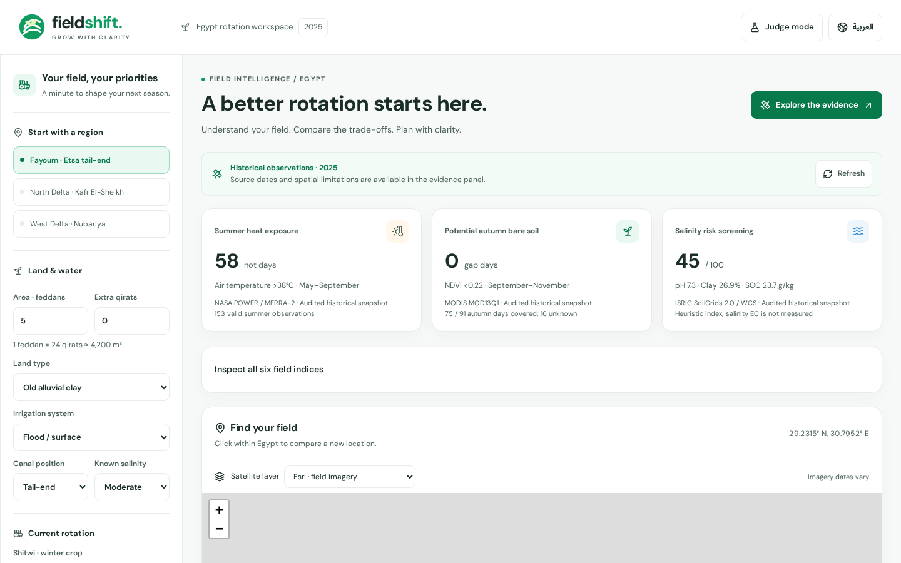
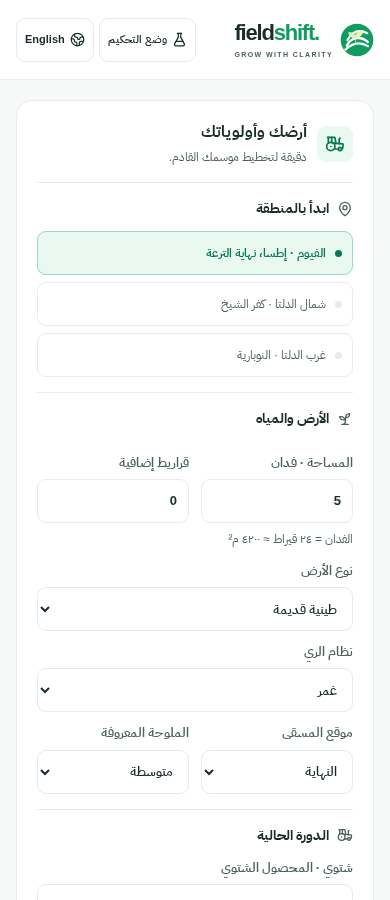

# FieldShift journey audit and proposal

Issue: [#20](https://github.com/Davidelksfam/FieldShift/issues/20). Baseline: main `792e186`.

## Observed experience

Captured the rendered app in Chromium at 390, 768 and 1440 CSS pixels, in Arabic and English. External requests were blocked to exercise historical snapshot / regional fixture fallback; map imagery was therefore unavailable. Measurements: [baseline-measurements.json](baseline-measurements.json).

| Priority | Evidence | Decision |
| --- | --- | --- |
| P0: decision is buried | Comparison begins at y=2,884 AR / 2,988 EN on phones, y=1,190 on desktop. The mobile viewport contains settings, not the product question. | Five freely navigable workspace steps; one-click demo opens comparison. |
| P0: competing tasks | 25 input/select controls precede comparison; technical coordinates are always exposed. No back/next or scenario review. | Separate field, farm, goals, comparison and evidence; coordinates in advanced disclosure; persistent scenario summary. |
| P0: reading burden | 61–63 rendered text elements below 12px; full evidence explanations precede crop choices in every card. | Crop timelines and modeled water first; explanation and local checks expandable; captions at least 12px. |
| P1: desktop-to-tablet collapse | At 768px, a 240px settings sidebar consumes space while alternatives stack. | Full-width workspace with compact step navigation; compare all or inspect baseline + one alternative. |
| P1: controls lack intent | Priority sliders offer raw numbers without an entry point; crop icons are identical. | Goal presets preserve relative-weight semantics; custom weights available; crop-specific Lucide symbols. |
| P1: judge navigation | Evidence and pipeline require scrolling past the whole farmer workspace. | Judge Mode jumps to evidence, opens charts and retains all five stages and JSON. |

The baseline has working focus outlines, RTL direction, provenance and fallback messaging. These must survive the redesign. Passing existing tests does not resolve the hierarchy problems above.

## Proposed information architecture

1. **Field**: product question, one-click Fayoum demo, three distinct benchmark regions, optional map and advanced coordinates; scope is Egypt and co-located regional/pixel analysis.
2. **Farm**: current crops, area, irrigation, land and canal conditions; immediate state updates, no submission gate.
3. **Goals**: balanced / water / soil presets, raw weights visible, optional custom editor and conditional Nili scenario.
4. **Compare**: current reference and up to two valid alternatives; timelines, modeled demand and differences, nitrogen index, meaningful caveats, expandable explanations/checklists. Edit farm/goals without losing state.
5. **Evidence**: plain-language observations and missingness before charts, six indices, provenance and Judge Mode pipeline.

All steps remain directly accessible. Back/next are conveniences, not validation barriers. Shared state and fetch dependencies remain in App; navigating or editing goals must not fetch again. Preserve exact engine results and historical/source language.

## Before

Full capture set includes both languages at all three widths, comparison and open evidence.
