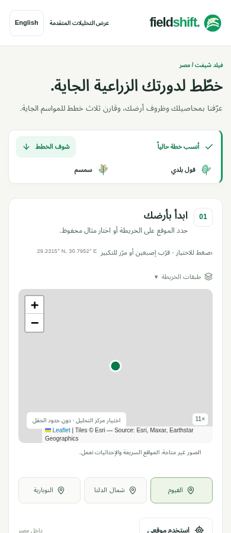
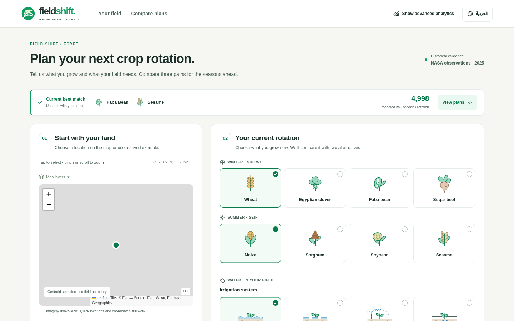
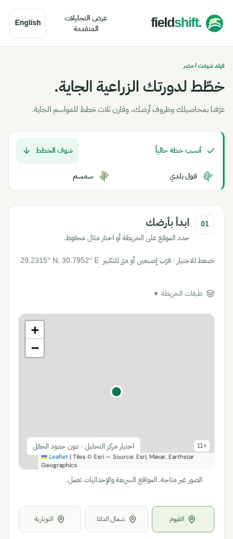
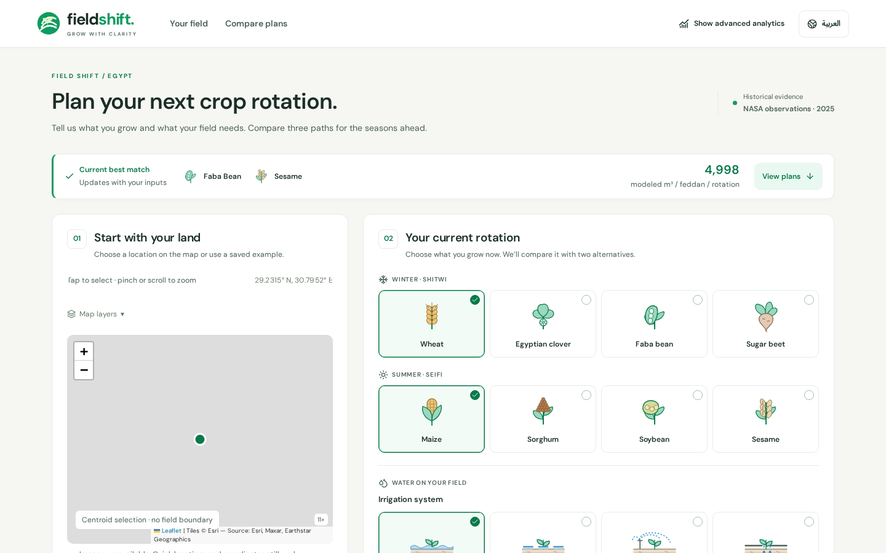

# Unified workspace review — 2026-11-14

Main advanced to `89f05e3` (PR #40) after the original PR #22 was prepared. Its [documented user-requested unified workspace](../product/UNIFIED_FARMER_WORKSPACE.md) supersedes the earlier five-step proposal. This PR now preserves that workspace and all intervening scientific/source changes. Earlier audit and screenshot files in this directory are historical records, not the current UI specification.

## Evidence and scope

Rendered the current application in Chromium at 390, 768 and 1440px in Arabic and English. No horizontal page overflow appeared at those widths. The live summary offers one-action access to comparison despite the long illustrated form; the UI intentionally keeps farmer factors on the same page. No wizard or separate input workspace was reintroduced.

The rendered audit found three undersized actions: mobile **View plans** was 36px high, **Map layers** approximately 17px, and the coordinate-submit action 36px at tablet/desktop. These now meet 44px, as do coordinate fields. Navigation links have an explicit 44px minimum height. Supporting map/control text and live summary labels use at least 12px.

At the 195px CSS viewport representing 200% reflow of a 390px viewport, the existing form overflowed. Narrow layouts now wrap header controls, stack illustrated choices/measurements, omit only decorative toggle illustrations, and let the live summary scroll normally. The same controls, labels, source gating and analytics remain accessible. No overflow is concealed with a page-level clipping rule.

Only presentation CSS and an additional accessibility browser test change relative to latest main. Shared App state, radio semantics, all crop constants, ranking, Scientific V2 flag, data fetching, offline behavior, illustrative acknowledgement and production settings are preserved. Superseded journey components were removed from the branch; collaborators' current components and regression tests were kept.

## Checks

Baseline main: `npm run check` passed **129 tests**, build and repository checks; all **27 browser scenarios** passed.

Final verification:

- `npm run check`: **129 unit/integration tests**, production build and repository/link checks passed.
- `npm run test:browser`: **29 scenarios passed**, retaining all 27 current-main scenarios and adding touch-target and 200% reflow regressions.
- `npm run test:browser:v2`: **4 scenarios passed** in the separate experimental build; default V2 activation is unchanged.
- `npm run validate:water-reference`: the existing published-reference numerical checks passed.
- Source/engine/data/brand/config diffs relative to main are empty. The only application source change is `src/workspace.css`; `git diff --cached --check origin/main` passes for the reviewed changes.
- Actual screenshots reviewed in both languages at all three target widths. The measured undersized button/disclosure count fell from two per capture to zero; explicit coordinate controls were also opened and checked in the browser tests.

Browser testing uses the production bundle. The 200% test uses half-width CSS viewports (195/384/720px), not manual browser-chrome zoom. No physical-device, screen-reader or agricultural validation is claimed.

## Before / after

| Arabic mobile | English desktop |
| --- | --- |
|  |  |
|  |  |

The screenshot set covers both languages at 390, 768 and 1440px. [Before measurements](screenshots/current-before/report.json), [after measurements](screenshots/current-after/report.json) and [reflow observations](current-reflow-measurements.json) accompany the captures. Third-party requests were blocked during repeatable captures; unavailable map tiles remain labeled. This tests fallback layout, not live provider availability.

## Delivery limits

The original FieldShift preview build and GitHub application checks succeeded. The separate legacy **Vercel – skyspace** integration also attached a failing check to the PR. That project targets the historical `web/` application; this task does not change its deployment settings. FieldShift's production deployment remains unchanged. No merge into main or production release is part of this review.
