> Historical record of the earlier five-step proposal on PR #22. The user-approved unified workspace on main supersedes this interface. See [the current review](CURRENT_WORKSPACE_REVIEW.md) for the active layout and checks.

# UX verification — 2026-11-13

Scope: frontend-only redesign on `feat/ux-journey-redesign`, started from main `792e186` and integrated the concurrent crop-science update `af70509` (PR #21). No scoring, crop constants, data files, schemas, fetching semantics, service worker or production configuration changed.

The concurrent update's measured laboratory ECe input/validation, FAO reference disclosure, water-model caveat and all new science modules/tests are preserved. The redesign does not modify the engine/data files relative to latest main. Baseline screenshots intentionally document the original starting revision.

## Automated evidence

- `npm run check`: **27 unit tests passed**, Vite production build passed, repository/link check passed.
- `npm run test:browser`: **10 scenarios passed** against the local production bundle. All seven earlier regression themes are retained, with navigation adapted to the new journey.
- Goal input-to-paint p90: **34.5 ms** over 12 changes in local headless Chromium; goal and irrigation changes caused no additional API requests. This is a local result, not a guarantee on all devices.
- Both languages and all five steps checked at 390, 768 and 1440px; no page-level overflow.
- 200% **reflow equivalent** checked by halving those CSS viewport widths to 195, 384 and 720px. Headless Chromium has no browser-chrome zoom control; this does not claim manual browser-zoom testing or physical-device validation.
- Keyboard skip link, Enter navigation, heading focus, visible control focus, reduced-motion styles, 44px visible button/disclosure targets at 390px.
- Offline service-worker reload and preset switching; all remote sources failing; incomplete POWER cannot replace audited history; map selection/overlays/manual coordinate validation.
- Goal presets/custom weights, score/rank updates, farm edits and invalid area recovery; all/current+water/current+soil comparison; conditional Nili; evidence tables, six indices and all five raw JSON stages.

## Unmocked local smoke run

`DEMO_BASE_URL=http://127.0.0.1:4173 npm run test:live` passed against the local production bundle with real external requests. The existing hypothetical counterfactual remained 8,843 m³/feddan and 1,970 m³/feddan difference; this is a model regression check, not a field outcome. Ten Esri tiles and two NASA GIBS tiles loaded; no page errors. Climate refreshed from NASA POWER while soil/NDVI retained audited observed snapshots after upstream failures/timeouts (PixelGust connection failed; ISRIC/ORNL requests were aborted). No claim that every live provider was available. See the [recorded smoke report](unmocked-smoke.json). The script's locators were adapted to the new navigation; its default production URL/configuration was not changed and production was not contacted for this check.

## Actual visual review

Captured and inspected rendered screenshots rather than treating test success as a design verdict. Checked desktop hierarchy, tablet card proportions, Arabic mobile controls, mobile comparison legibility and evidence disclosure. Initial implementation's mobile summary was too tall; it was replaced by a compact review disclosure and a small direct metric comparison. Tablet card heading rows were aligned after inspection.

Baseline measurements and final captures use blocked third-party requests to make fallback states reproducible. Historical snapshots retain their observed-source labels; the North Delta soil fixture retains its illustrative label. Screenshots with an open map therefore show unavailable remote tiles, not substituted satellite imagery.

| 390px | Before comparison start | After demo comparison start | After metric summary |
| --- | --- | --- | --- |
| Arabic | 2,884px | ~442px | ~547px |
| English | 2,988px | ~508px | ~613px |

These compare the old continuous page with the new comparison destination, reached with **one primary demo action**. The demo button is visible in the initial 900px viewport in both languages. This is an information-architecture improvement, not a claim about farmer study results. See [baseline measurements](baseline-measurements.json) and [after measurements](after-measurements.json).

## Before / after

| English desktop | Arabic mobile |
| --- | --- |
| 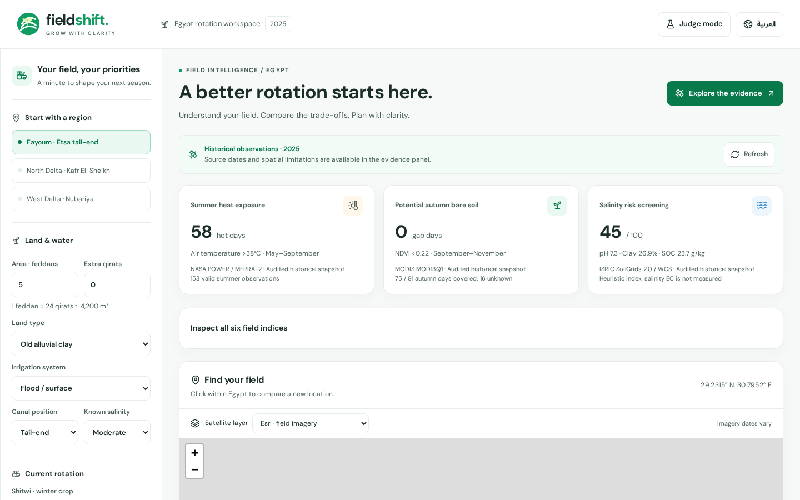 | 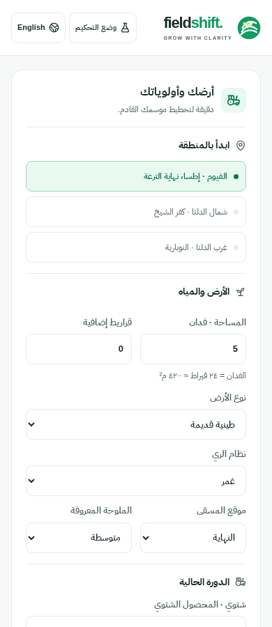 |
| 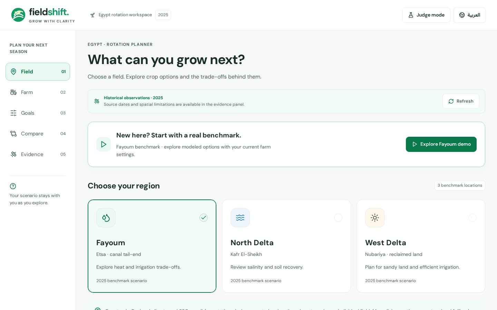 | 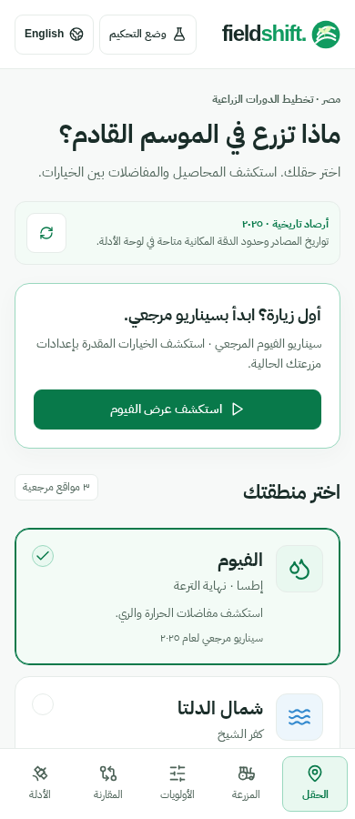 |

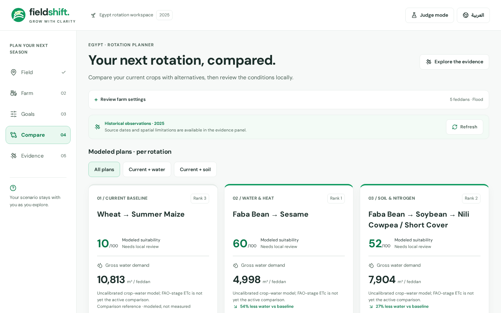
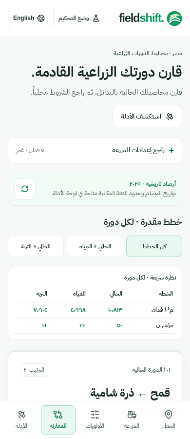
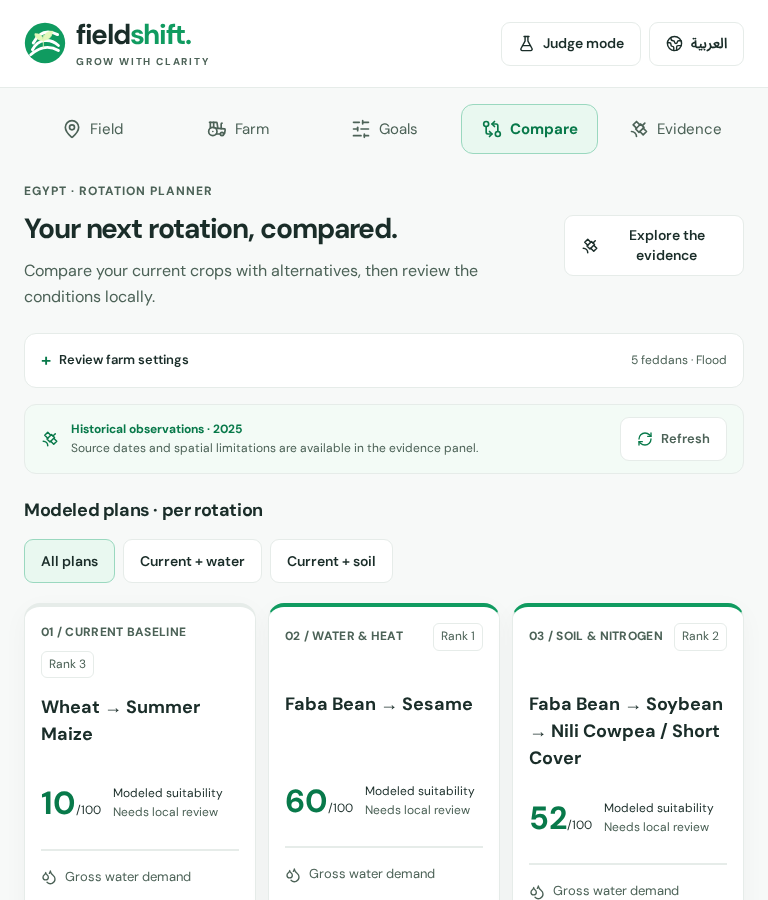
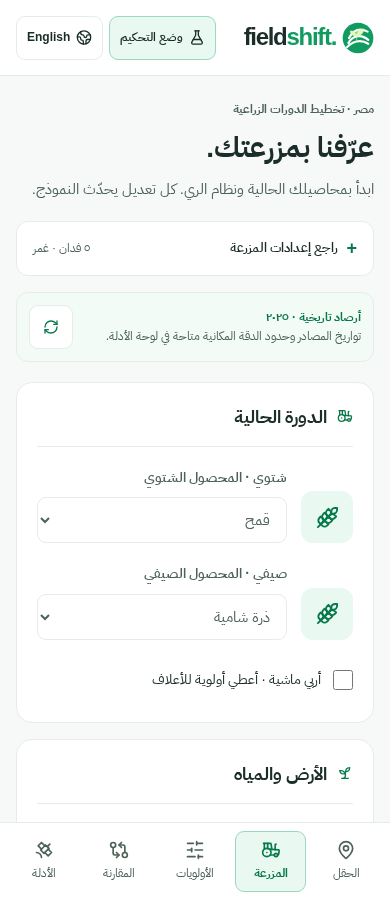
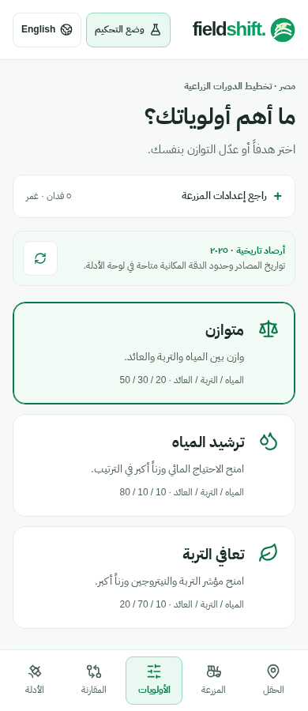
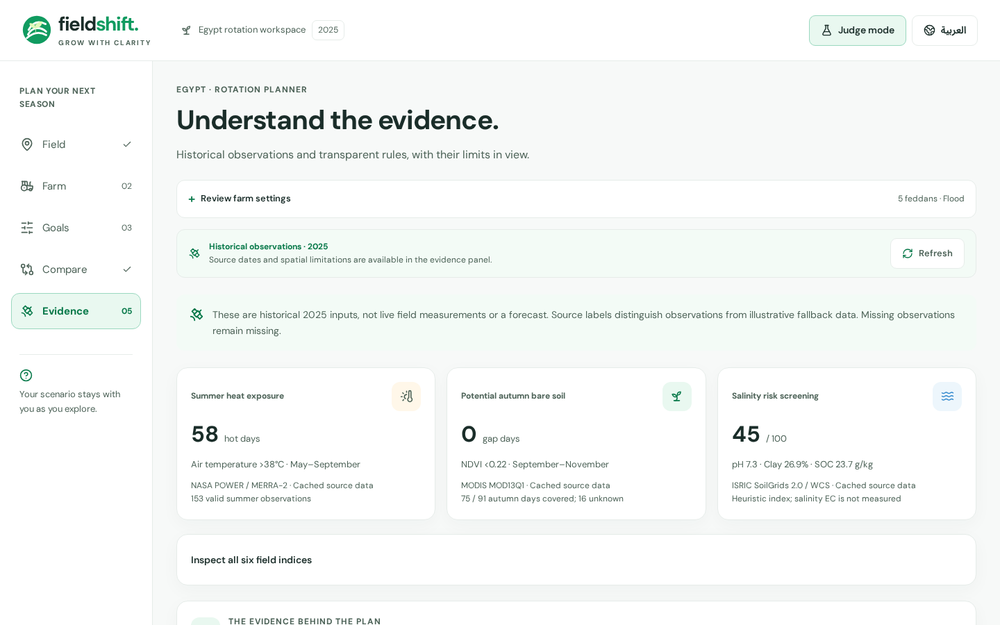
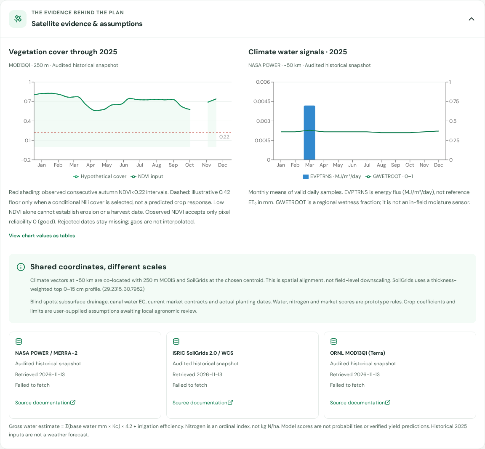
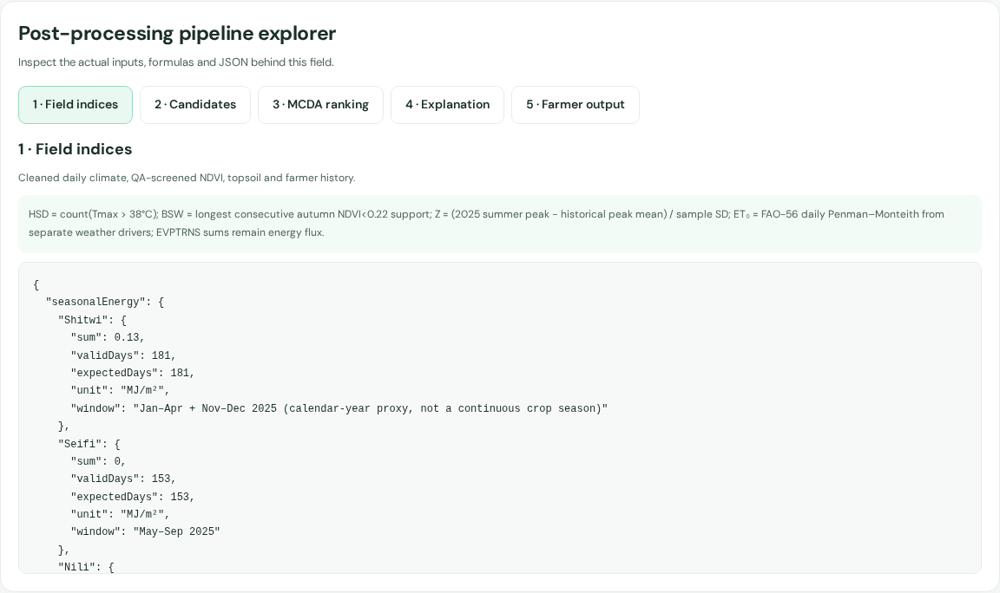

The committed screenshot set includes entry and comparison in both languages at all three requested widths, plus farm, goals and Judge Mode evidence on Arabic mobile and English desktop.

## Limitations and reviewer checks

- No farmer usability study, agronomic validation, screen-reader session or physical-device test was performed. Arabic content should receive local farmer/extension review.
- Local browser screenshots and automated tests are Chromium only; manual Safari/Firefox and browser-chrome zoom review remain useful.
- Comparison filters reset when leaving the comparison step; farm, field, weights and language persist while navigating. Scenario persistence across reloads remains outside this change.
- Source availability and remote imagery depend on connectivity. Missing data, historical context, native resolution and uncalibrated-water caveats remain accessible; UI changes do not validate any outcome.
- No merge or production deployment was performed. Review through the pull request before release.
